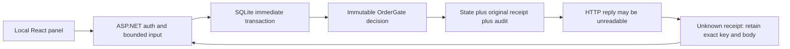

# Trading Execution Lab: architecture case study

Documentation edition: 10 November 2026. Original synthetic/local work prepared with AI assistance for Pouria Jamali. This is a selected architecture-and-evidence review, not an exhaustive code or security audit.

Runtime: [`v0.5.2-preview.1`](https://github.com/pouriajamali/trading-execution-lab/releases/tag/v0.5.2-preview.1) at `779f654dec7efe07c0e106dba9c438c6b5775eb2`. The later documentation branch does not replace that runtime identity.

[Machine-readable evidence](FLAGSHIP-EVIDENCE.json) · [30-minute four-project review](https://github.com/pouriajamali/trading-execution-lab/blob/main/docs/FLAGSHIP-REVIEW.md) · [Installation](../README.md)

## Problem: a missing response does not identify the transaction outcome

A reservation consumes capacity before an order can be filled. Retrying a request after an unreadable HTTP response must not reserve twice. At the same time, a historical retry must not replace newer committed state with the old snapshot. The useful finance/backend responsibility here is the boundary between business admission, durable intent and operator uncertainty.

The simple walkthrough starts with 4 filled lots and 3 working lots against a limit of 10. A reservation of 2 moves exposure from 7 to 9. The same key and body replay the original receipt without another reservation. A different request for another 2 is denied. These are synthetic integer lots, not orders sent to a venue.

## Architectural decision: make the receipt part of the commit

The actual HTTP path validates the token, operator subject/role and bounded input, then uses a SQLite immediate transaction. The immutable gate decision, resulting state, original idempotency receipt and audit outbox commit together. Reusing a key with a different body is a conflict. Returning an original receipt does not mean that receipt describes the latest state; the panel fetches current state separately.



The in-memory `SerializedExecutionSession` is a separate host over the same model. The HTTP path does **not** pass through its channel; SQLite serializes independent connections. The browser-only JavaScript demo is another implementation and is not proof that C# or SQLite executed.

The panel treats a missing/invalid response as an unresolved receipt, labels failed refreshes stale and blocks a new request while that uncertainty remains. It must recover the original request identity rather than silently inventing a replacement command.

## Alternatives excluded by this contract

These are architectural trade-offs, not a benchmark comparing technologies.

| Alternative | Why the lab chooses otherwise | Cost of the chosen boundary |
| --- | --- | --- |
| Commit state, then write a receipt or audit separately | A failure between writes could leave no durable way to identify the original result | One SQLite transaction couples the three records and serializes writers |
| Create a new request key after a timeout | The first request may already have committed | The client must retain and resolve the exact key/body |
| Return current state as the answer to every historical retry | A later state is not the result originally associated with that request | Receipt and current-state views must remain separate |
| Release capacity immediately on a cancel request | A fill can arrive before cancellation confirmation | Pending cancellation retains capacity; an unknown late fill requires reconciliation |
| Present a successful browser mock as backend proof | It does not exercise the HTTP transaction or disk state | The actual packaged backend and the browser-only demo need separate evidence |

## Counterexamples and named executable evidence

| Counterexample / failure | Expected outcome | Frozen source evidence |
| --- | --- | --- |
| Failure before commit after attempted writes | State, receipt and audit roll back together; retry remains possible | [`FailureBeforeCommitRollsBackAllThreeWritesAndAllowsRetry`](https://github.com/pouriajamali/trading-execution-lab/blob/779f654dec7efe07c0e106dba9c438c6b5775eb2/ExecutionLab.Tests/DurabilityTests.cs) |
| The same key races across connections | One committed effect and original-result replay | [`ConcurrentSameKeyHasOneCommittedEffect`](https://github.com/pouriajamali/trading-execution-lab/blob/779f654dec7efe07c0e106dba9c438c6b5775eb2/ExecutionLab.Tests/DurabilityTests.cs) |
| A retry arrives after later successful commands | Its old receipt is returned without rolling current state back | [`HistoricalRetryDoesNotRollbackLaterCommittedState`](https://github.com/pouriajamali/trading-execution-lab/blob/779f654dec7efe07c0e106dba9c438c6b5775eb2/ExecutionLab.Tests/DurabilityTests.cs) |
| Fill/cancel ordering exposes uncertain actual state | Retain capacity or explicitly require reconciliation | [`CancelFillOrderingsRetainCapacityOrExplicitlyRequireReconciliation`](https://github.com/pouriajamali/trading-execution-lab/blob/779f654dec7efe07c0e106dba9c438c6b5775eb2/ExecutionLab.Tests/BoundaryTests.cs) |
| A signed operator token has an empty subject | No authorization to mutate | [`EmptySubjectCannotAuthorizeAnOperator`](https://github.com/pouriajamali/trading-execution-lab/blob/779f654dec7efe07c0e106dba9c438c6b5775eb2/ExecutionLab.Tests/BoundaryTests.cs) |

The earlier audit also found a stale **Ready** UI after failed refresh and an empty-subject JWT that could mutate the gate. Their actual first failures and fixes are documented in the [existing case study](CASE-STUDY.md). Its dated browser audit used a test-only loopback proxy to truncate a response **after** a real backend commit; replay recovered the original receipt. This historical audit is distinct from the later release CI. No new failure experiment or profiling run was performed to write this document.

Read the frozen implementation in [`DurableGate.cs`](https://github.com/pouriajamali/trading-execution-lab/blob/779f654dec7efe07c0e106dba9c438c6b5775eb2/ExecutionLab.Persistence/DurableGate.cs), [`GateApi.cs`](https://github.com/pouriajamali/trading-execution-lab/blob/779f654dec7efe07c0e106dba9c438c6b5775eb2/ExecutionLab.Api/GateApi.cs) and [`OrderGate.cs`](https://github.com/pouriajamali/trading-execution-lab/blob/779f654dec7efe07c0e106dba9c438c6b5775eb2/ExecutionLab/OrderGate.cs). The existing [decision/test map](https://github.com/pouriajamali/trading-execution-lab/blob/779f654dec7efe07c0e106dba9c438c6b5775eb2/docs/CASE-STUDY.md) contains the wider auth, panel, launcher and endpoint checks.

## Versioned evidence and reproduction

The evidence index below binds the runtime to `v0.5.2-preview.1`, not to the moving documentation branch. The retained delivery receipt records, on **each matching Windows/Ubuntu release target**, 56 C# cases, 11 JavaScript protocol tests, 16 controlled launcher scenarios and 22 actual extracted-package HTTP/SQLite checks. Launcher stubs are not 16 independent OS installations. The public tag CI is linked separately from the source branch CI.

For a fresh reproduction, first verify the downloaded release with [PROVENANCE.md](../PROVENANCE.md) and the independently trusted key pin. Extract the entire matching archive, satisfy the documented ASP.NET Core 10.0.14-or-later 10.0 x64 and PowerShell 7 prerequisites, and follow the [quick start](https://github.com/pouriajamali/trading-execution-lab/blob/779f654dec7efe07c0e106dba9c438c6b5775eb2/docs/QUICKSTART.md):

```powershell
# Run from the extracted Windows package.
pwsh -NoProfile -File .\Start-OperatorPanel.ps1
```

```sh
# Run from the extracted Ubuntu/glibc package.
pwsh -NoProfile -File ./Start-OperatorPanel.ps1
```

Use the actual local API/panel to inspect 7→9 acceptance, exact replay and refusal. The launcher creates disposable synthetic state. For source-level checks, check out the frozen runtime commit and run `dotnet run --project ExecutionLab.Tests/ExecutionLab.Tests.csproj -c Release`. Consult that commit's workflow for the full packaged-check procedure. These are reproduction instructions; this documentation change did not execute them.

## Limits and review questions

- One synthetic gate, direction/instrument and trusted normalized facts. Operators share the gate; this is not tenant order ownership.
- SQLite process reopen and pre-commit exceptions do not prove power-loss durability, arbitrary storage recovery or exactly-once transport. Retention/migration policy and synchronous SQLite contention remain limitations.
- The panel exposes reservations and read-only state. Fill/cancel reasoning belongs to model/durable tests. Reloading the tab can lose an unresolved request identity.
- Packages are framework-dependent x64 developer previews. SSH provenance is separate from Authenticode, production suitability or exclusive authorship.
- Old v0.3 measurements describe their own measured source. They do not establish performance for this UI/API release.

Review prompts: Where is the commit boundary? Why can a denial still have a committed receipt? What can the UI safely say after an unreadable reply? Which invariant would a second database or tenant require you to redesign?

## Short introduction — English

An AI-assisted C#/.NET lab for retry-safe risk reservations. A SQLite transaction commits gate state, the original idempotency receipt and an audit outbox together; the local panel keeps unknown replies separate from current state. Its evidence is synthetic and local, with no live trading or production-performance claim.

## معرفی کوتاه — فارسی

این آزمایشگاه C#/.NET با کمک هوش مصنوعی، رزرو ریسک و تکرار امن درخواست را نشان می‌دهد. وضعیت گیت، رسید اصلی و audit در یک تراکنش SQLite ثبت می‌شوند و پنل، پاسخ نامعلوم را از وضعیت جاری جدا نگه می‌دارد. شواهد مصنوعی و محلی‌اند و ادعای معاملهٔ زنده یا عملکرد production ندارند.

## Reading the evidence without overstating it

The [evidence index](FLAGSHIP-EVIDENCE.json) records the exact runtime commit/tree, signed tag object, public tag CI, published asset IDs/sizes/SHA256 values and named source checks. Those are existing delivered results, not tests executed for this document. Use the [tag CI](https://github.com/pouriajamali/trading-execution-lab/actions/runs/42253983786) and [release](https://github.com/pouriajamali/trading-execution-lab/releases/tag/v0.5.2-preview.1) rather than a moving green badge. A CI artifact may expire; the frozen source and signed published downloads remain the reproduction entry points.

The expected SSH fingerprint is `SHA256:AgU5bZlJSjUu0KsWMmVEEr+BfXpcMVNroTA33bHcQdU`; confirm it through an independently trusted channel before accepting a download. AI assistance and laboratory scope remain explicit. A walkthrough can examine a person's understanding; repository count, signatures and passing tests alone do not establish independent skill, employment history, adoption or people-management experience.
