# A reservation response can disappear after the transaction commits

This independent synthetic example examines one narrow responsibility: retain
order capacity and make retries observable without reserving twice. It is authored
for Pouria Jamali with AI assistance. It contains no employer/shared private code,
real account or market data, live adapter, production or profitability evidence.

## Two state owners, one model

The React panel sends an immutable `{orderId, quantity}` command with a fresh
`Idempotency-Key` to `/reservations`. The actual .NET request path is:

```mermaid
flowchart LR
    UI[React: in-memory token and exact retry] --> JWT[JWT signature / issuer / audience / expiry]
    JWT --> Role[Nonempty subject and operator role]
    Role --> Validate[Bounded key, order ID, positive Int64 quantity]
    Validate --> Tx[SQLite immediate transaction]
    Tx --> Core[OrderGate immutable decision]
    Core --> Atomic[Commit state + original receipt + audit outbox]
    Atomic --> Reply[HTTP decision; current state fetched separately]
```

The separate `SerializedExecutionSession` is an **in-memory** multi-producer,
single-consumer host over the same `OrderGate`. The HTTP path does **not** route
through that channel host: SQLite serializes independent connections instead.
Neither local cursor reconstructs exchange/feed ordering. Audit's inbox/counter
is another local transaction illustration, not a broker transport or order sender.

## Decisions and observable proof

| Decision / boundary | Code | Named executable evidence |
| --- | --- | --- |
| Reserve filled + all outstanding quantity before admission | `OrderGate.cs` | `ExactLimitIsAllowed`, `FilledPlusPendingBlocksNewOrder`, `ConcurrentReservationsCannotOversubscribe` |
| Cancel request keeps capacity; fill before confirmation counts; a late unknown fill halts for reconciliation | `OrderGate.cs`, `DurableGate.cs` | `FillDuringCancelPendingStillCounts`, both `CancelFillOrderingsRetainCapacityOrExplicitlyRequireReconciliation` cases |
| Commit state, historical receipt and audit together, even for a consumed risk denial | `DurableGate.ApplyForTest` | `FailureBeforeCommitRollsBackAllThreeWritesAndAllowsRetry`, `DeniedCommandStillCommitsStateReceiptAndAudit` |
| Same key/body returns the old receipt; different body conflicts; connections serialize | `DurableGate.cs` | `HistoricalRetryDoesNotRollbackLaterCommittedState`, `ConcurrentSameKeyHasOneCommittedEffect`, `RacingDifferentBodiesOnOneKeyCommitOnlyOneReceipt` |
| Reopen retains state/receipt; audit redelivery does not repeat inbox/counter effect | `DurableGate.cs` | `ReopenAndRetryPreservesOriginalReceiptWithoutNewEffects`, `RedeliveryAfterConsumerCommitDoesNotRepeatProjectionEffect` |
| Invalid JWT, wrong role, missing/blank subject cannot mutate; operators share one gate | `GateApi.Configure` | `HttpPipelineValidatesTokenRoleInputIdempotencyAndRiskDenial`, `EmptySubjectCannotAuthorizeAnOperator` |
| Invalid/unrepresentable input makes no writes; arithmetic overflow persists a halted model | `GateApi.cs`, `OrderGate.cs` | `InvalidHttpBodiesDoNotWriteAnyTransactionalEffects`, `OverflowDecisionPersistsAHaltAndHistoricalReceipt` |
| Login is opt-in/rate-limited; state requires operator auth; code/token are run-only | `PanelApi.cs`, launcher | `LocalPanelRequiresLoginAndReadsTheSameSyntheticGate`, `PanelLimitsLoginAttemptsAndRequiresOperatorForState`, protocol transport and closed DTO/byte-limit tests |
| API-only and panel modes reject foreign Host/peer; configured Kestrel endpoints cannot widen binding | `Program.cs` | actual extracted-package `check_package.py`: bad Host and reject-configured-endpoint/no-DB checks |
| A response/schema error means an unknown receipt, not rollback; stale state is labelled and new requests blocked | `OperatorPanel/src/main.tsx`, `protocol.ts` | protocol lost/unreadable response tests; real-backend browser audit with one deliberately truncated response after actual commit |
| Launcher propagates child failure, restores environment and deletes only its own temporary directory | `Start-OperatorPanel.ps1` | `check_launcher.py`, clean/exit17/invalid-code cases; standalone exit probe substitutes only secure input acquisition |

The current local suite has **56 C# cases** (original 24 model and 9 hosting cases
retained) and **11 JavaScript protocol tests**. The workflow builds the panel and
fresh RID-specific framework-dependent packages on matching Windows/Ubuntu
hosts. Each extracted bundle runs **22 actual HTTP/SQLite checks in four owned
processes**: auth/static assets, 7→9 acceptance, replay/conflict/denial, invalid
input, on-disk atomic effects, process reopen, and seed/endpoint startup refusal.
These package counts describe required workflow checks; they do not assert that
Linux ran at the time of the dated local audit. Public release requires both
matching-OS jobs to execute the archives successfully. This uses an installed
ASP.NET Core runtime; an SDK-free physical host is not
claimed as tested. Archive inventories/checksums link these checks to downloads.
Assess the [exact release workflow](https://github.com/pouriajamali/trading-execution-lab/actions/workflows/ci.yml),
not a generic green badge or a different source revision.

## Genuine first failures and fixes

The 5 November audit began at `53b97511a0b51e2b5283a5c536e7ffe4edf40dd6`.

- After API stop, failed Refresh left the panel labelled **Ready** with old
  values. The fixed UI shows **Unknown / stale snapshot** and disables a new
  reservation. It never treats a failed response as rollback.
- A signed operator JWT with an empty or whitespace-only subject returned HTTP200
  and mutated the gate. Both new regression cases failed before the policy fix;
  the policy now requires a nonblank subject and the full 56-case suite passed.
- A standalone launcher probe with an injected child exit17 returned zero and
  left its disposable directory. The fixed standalone prompt-stub probe returns
  17; the separate environment/cleanup checks pass. A prompt-stub is not proof of
  interactive console Ctrl+C behavior. A separate real Windows PTY probe later
  observed masked input, real backend startup and Ctrl+C shutdown, and verified
  that its exact generated temporary directory was removed.
- Explicit Kestrel endpoint configuration overrode `Run(url)`; a first attempted
  preference setting was insufficient. The final guard rejects endpoint
  configuration before creating the DB. The reproduction used another loopback
  port; no public/LAN listener was opened for testing.

Raw first failures, development harness failures and green logs are preserved in
the private audit receipt. [`evidence/audit-20261105.json`](evidence/audit-20261105.json)
contains hashes, normalized observations and source/runtime/harness fingerprints;
it does not expose private paths, operator codes, signing keys or JWTs. These are
local development results; the per-commit Windows/Linux CI is separate evidence.

The browser audit exercised the actual .NET backend on desktop 1280px and mobile
390px, including a long order ID, accepted reservation, refusal at capacity,
missing/unreadable response, exact replay after relogin and failed refresh.
A test-only loopback proxy truncated a denial response **after** the real backend
committed sequence5/exposure10. The panel blocked a new request and the replay
returned the original denied receipt at sequence5; it did not advance the cursor.
This harness did not replace the backend with a JavaScript model. A second
test replaced a genuinely accepted response with valid JSON containing only
`accepted:true`. The client rejected its shape, retained the unknown request,
and after a successful state refresh still refused a changed-ID Enter submission
(zero additional reservation POSTs). Relogin and exact replay recovered the
original accepted sequence3/exposure9 receipt with the same key and body.
A separate
attempt to hold SQLite until an HTTP timeout did not establish response loss and
is excluded from that claim.

## Limits that matter

- One non-negative direction/instrument, trusted normalized snapshots/facts, one
  fictitious gate shared by all operators. No user/tenant order ownership claim.
- The panel exposes reservations and read-only state, **not** fill/cancel/resume
  controls. Fill/cancel ordering proof belongs to typed-model/durable tests.
- A cancellation confirmed before a later unknown fill is an anomaly requiring
  an authoritative snapshot; the model does not invent the missing actual state.
- A pre-commit exception, process reopen and omitted audit acknowledgement do
  not prove power-loss durability, storage corruption tolerance, network
  partitions, broker recovery, production correctness or exactly-once transport.
- Receipt/event/order ID stores and SQLite files have no bounded retention or
  migration policy. Synchronous SQLite calls serialize writers/block threads.
- Tokens/last command stay in tab memory only. Closing/reloading can lose an
  unresolved request's key. State is a last successful fetch, not a live stream.
- Framework-dependent, unsigned x64 developer preview. Native OS/runtime
  prerequisites apply. Matching-OS CI tests real packages; no Linux ELF execution
  on Windows or universal OS support is implied.
- Historical [v0.3 measurements](MEASUREMENTS.md) remain byte-preserved and tied
  to their measured source. **No new profiling dataset was generated for this
  correctness audit** and those results do not measure this UI/API/package build.

See [ADR 0001](decisions/0001-single-writer.md),
[ADR 0002](decisions/0002-transactional-control-plane.md) and [scope](../SCOPE.md).
